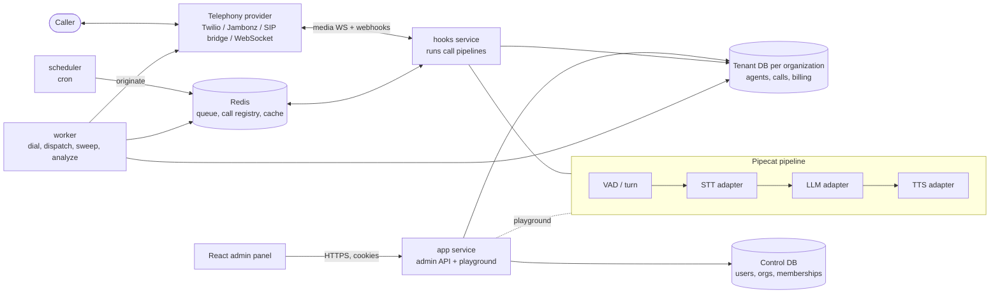
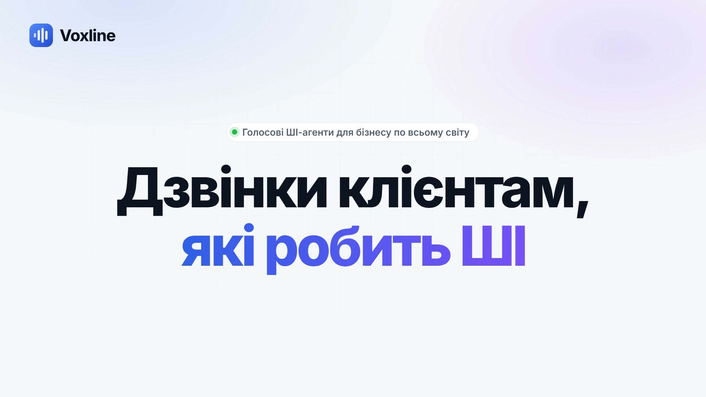
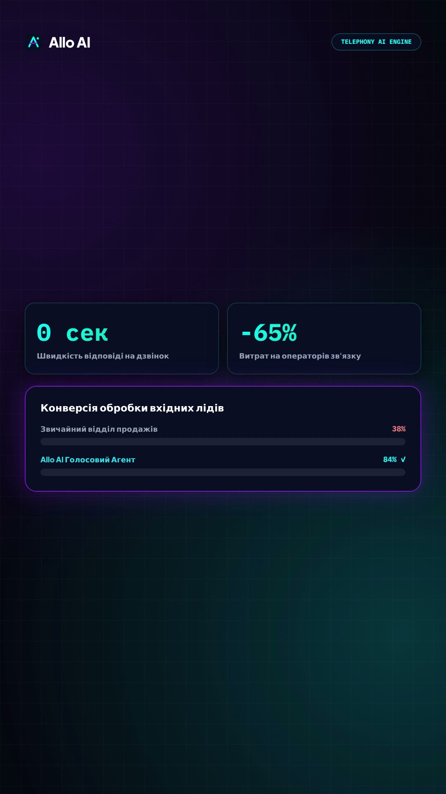
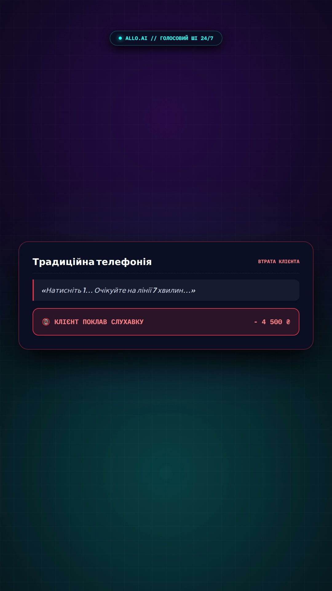

<div align="center">


**Provider-agnostic AI voice agents that answer and place phone calls for organizations.**
Brand: Allo AI. Code name: Voxline.

      

</div>

## Overview

Allo AI (Voxline) runs AI voice agents over real phone calls, inbound and outbound, for many organizations on one deployment. Each organization configures agents (prompts, call script, voice, and STT / TTS / LLM / VAD provider bindings), and the platform runs the conversation end to end: turn-taking, barge-in, per-language behavior, campaigns, SMS follow-ups and post-call analysis. It is built for teams that want to choose speech and language providers independently, from self-hosted models to paid vendor APIs, without touching engine code.

## Highlights

- **Provider-agnostic engine.** Adding a provider is one enum value, one adapter module and one DB row; the engine never branches on a vendor.
- **Real telephony pipeline.** Calls run as long-lived Pipecat pipelines in a dedicated hooks service (media WebSockets and status webhooks), not in request handlers.
- **Conversation quality as a feature.** Per-language turn timing and turn-detection trust, interruption handling that keeps history equal to what was actually spoken, and a latency benchmark module.
- **Strict multi-tenancy.** One control database (users, organizations, memberships) plus one PostgreSQL database per organization; cookie auth with rotating refresh tokens.
- **Outbound campaigns and SMS.** A taskiq worker and scheduler dial, dispatch campaigns and sweep stuck calls; SMS routes are bound separately from telephony trunks.
- **Full admin UI.** React panel with an in-browser agent playground (live audio, captions, pipeline state, per-turn timing), calls, models, providers, SMS and user management.

## Architecture



| Component | Entry point | Role |
|---|---|---|
| app | `src/main.py` | Admin HTTP API under `/api/v1`, auth, in-process playground calls |
| hooks | `src/main_hooks.py` | Telephony media WebSockets, status webhooks, runs real call pipelines |
| worker | `src/application/worker/tasks.py` | Taskiq tasks: `dial_call`, `analyze_attempt`, campaign dispatch, call sweep |
| scheduler | `taskiq scheduler` | Cron triggers for dispatch and sweep tasks |
| migrate | `src/bootstrap.py` | One-shot, idempotent: control and tenant migrations, first superuser and organization |

Adapters in `backend/src/integrations/`: STT (Deepgram, Cartesia, Voxtral, Qwen3-ASR, OpenRouter), TTS (Deepgram, Cartesia, Qwen3-TTS, OpenRouter), LLM (OpenAI-compatible), VAD (Silero), telephony (Twilio, Jambonz, SIP bridge, WebSocket), messaging (Twilio, Mamonty).

## Tech stack

| Layer | Technology |
|---|---|
| Backend | Python 3.13, FastAPI, async SQLAlchemy 2.0 (asyncpg), Alembic, gunicorn/uvicorn |
| Voice | Pipecat 1.8.1, Silero VAD, pluggable STT / TTS / LLM adapters |
| Jobs | taskiq + Redis Streams |
| Data | PostgreSQL 17, Redis 7 |
| Auth | Argon2 passwords, HS256 JWT access cookie, rotating hashed refresh tokens |
| Frontend | React 18, Vite, styled-components, en/ru i18n |
| Landing | Static nginx site (UA/EN) |
| Delivery | Docker, docker compose, GitHub Actions to GHCR, SSH deploy |

## Quick start

Requires Docker with compose.

```bash
cd backend
cp .env.example .env     # set SECRET_KEY, DB/Redis passwords, BOOTSTRAP_*
docker compose up --build
```

`migrate` runs first, then the admin API is on http://127.0.0.1:8086 (`/api`) and hooks on 8087. Sign in with `BOOTSTRAP_EMAIL` / `BOOTSTRAP_PASSWORD`.

Admin panel (separate terminal):

```bash
cd frontend
npm install
npm start                # http://localhost:3000, API at VITE_API_URL (default http://localhost:8086)
```

Without a backend: `npm run start:mock`. Local non-Docker setup: see [backend/Readme.md](backend/Readme.md).

## Configuration

Full list in [backend/.env.example](backend/.env.example); production template in [deploy/.env.example](deploy/.env.example).

| Variable | Purpose |
|---|---|
| `SECRET_KEY` | Signs session cookie and call/SMS callback tokens; production refuses placeholders |
| `APPLICATION_STATE` | `development`, `production` or `testing` |
| `ORIGINS` | Allowed CORS origins |
| `DB__HOST` `DB__USER` `DB__PASSWORD` | PostgreSQL connection |
| `DB__PREFIX` `DB__CONTROL_NAME` | Tenant database prefix and control database name |
| `REDIS__HOST` `REDIS__PASSWORD` `REDIS__TYPE` | Redis (standalone or Sentinel) |
| `JWT__SECRET` `JWT__ACCESS_TTL_SECONDS` `JWT__REFRESH_TTL_DAYS` | Token signing and lifetimes |
| `BOOTSTRAP_EMAIL` `BOOTSTRAP_PASSWORD` `BOOTSTRAP_ORG_NAME` | First superuser and organization |
| `CALL_WORKER__MEDIA_URL` | Public `wss://` URL telephony providers stream media to |
| `CALL_WORKER__MAX_CONCURRENT_CALLS` | Concurrent call cap |
| `LEADS__BOT_TOKEN` `LEADS__CHAT_ID` | Optional Telegram target for the landing demo form |

Frontend: `VITE_API_URL`, `VITE_DEV_PROXY_TARGET` (see [frontend/Readme.md](frontend/Readme.md)).

## Project structure

```text
backend/            FastAPI app, call engine, worker, migrations, tests
  src/application/  engine (pipeline, turn, language), services, worker
  src/integrations/ stt, tts, ttt, vad, telephony, messaging adapters
  src/core/         auth, control DB, db/session, redis
  tests/            engine, api, auth, worker suites
frontend/           React + Vite admin panel, mock API, node tests
landing/            Marketing site (nginx)
deploy/             Production compose and deployment guide
promo-video/        Promo video sources and renders
.github/workflows/  backend, frontend, landing CI/CD
```

## Testing and CI

| Scope | Command | Needs |
|---|---|---|
| Engine | `cd backend && uv run pytest tests/engine` | nothing external |
| Auth | `uv run pytest tests/auth` | PostgreSQL |
| API and worker | `uv run pytest tests/api tests/worker` | PostgreSQL, Redis |
| Frontend | `cd frontend && npm test` | Node |

GitHub Actions: the frontend workflow runs lint, tests and build; the backend workflow runs `uv sync --frozen` and `ruff check` (rules F, E9). Pushes to `main` build images to GHCR and deploy over SSH.

## Media

<p align="center">
    
</p>

Promo video: [promo-video/brag.mp4](promo-video/brag.mp4), explainer: [brag-output-explainer/allo-explainer.mp4](brag-output-explainer/allo-explainer.mp4).

## Status and roadmap

- Work in progress; no published release, benchmarks or production usage figures in this repository.
- Backend CI does not run pytest: the DB-backed suites (api, worker, auth) hang in CI and are run locally against dev containers.
- The engine suite expects an interpreter with Pipecat installed; see the comments in `backend/pyproject.toml`.
- The deployment guide in `deploy/` is written in Russian.
- No LICENSE file is present; all rights reserved by default.

## Author

Vladislav Shmalii, Full-Cycle AI Engineer. Repository: [github.com/Vladshmalii/voxline](https://github.com/Vladshmalii/voxline).
